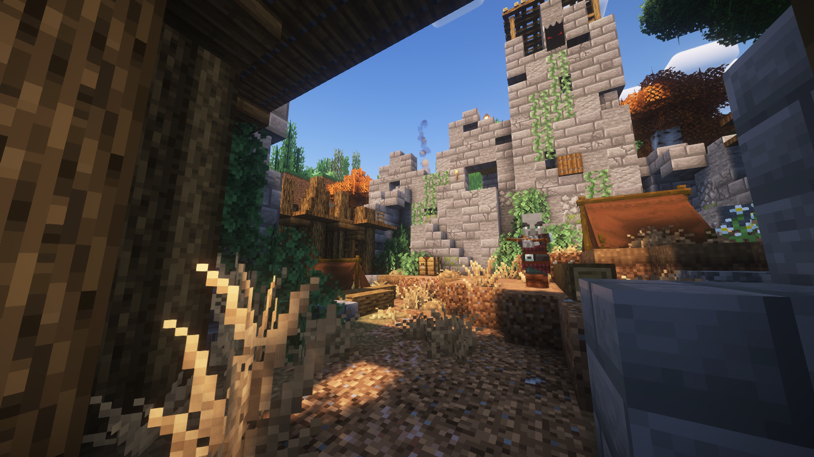
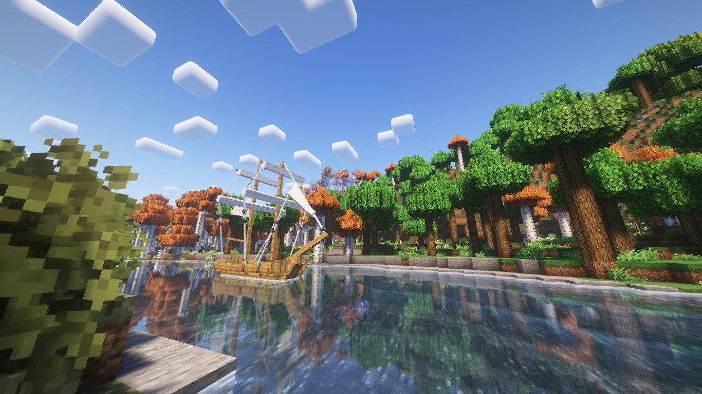
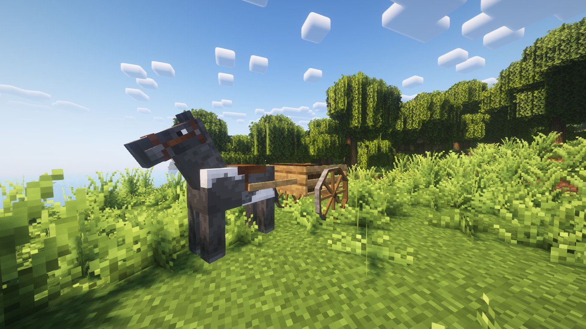
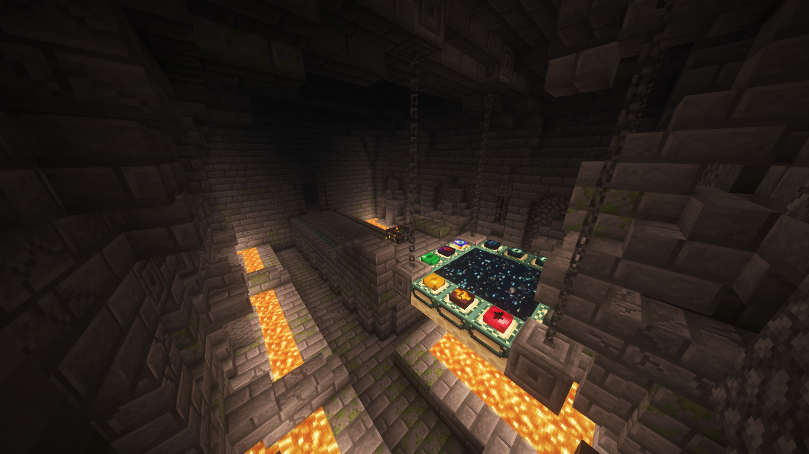
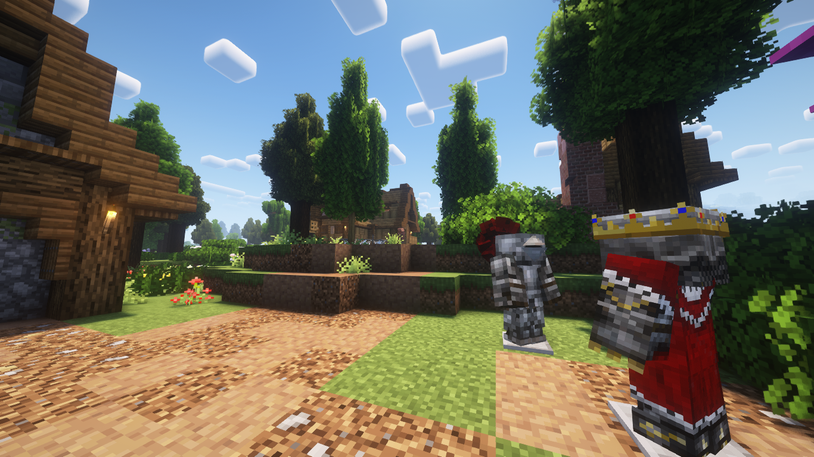
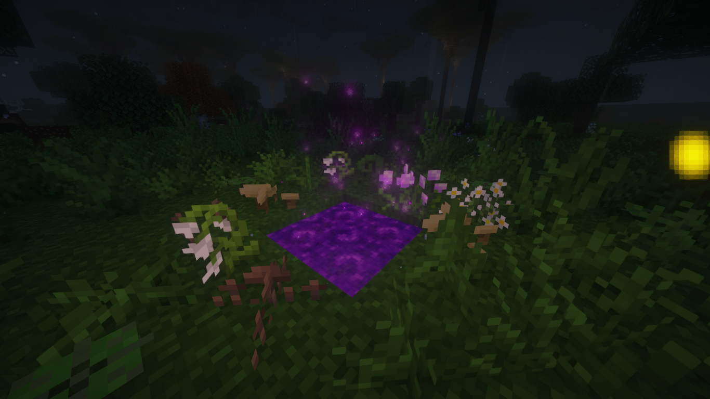
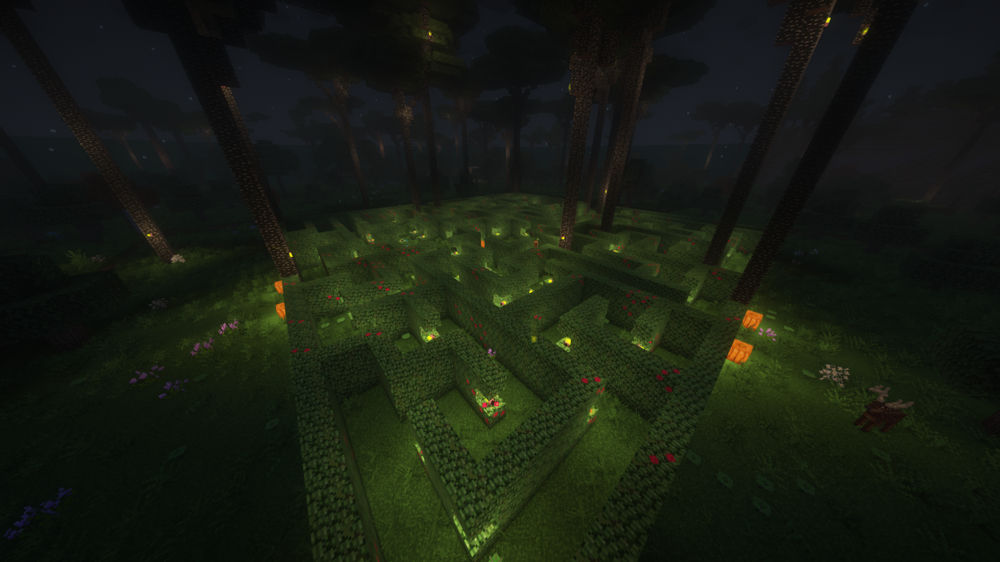

# 🏰 Kosyack Craft

**Kosyack Craft** — сборка Minecraft, которая позволит погрузиться в атмосферу настоящего Средневековья. Исследуйте живописные земли, добывайте ресурсы, стройте величественные корабли и неприступные замки, сражайтесь с опасными противниками и открывайте забытые сооружения, хранящие тайны прошлого.

Ваша история начинается с выживания в суровом мире. Используйте доступные возможности, развивайте свои навыки и создавайте собственное средневековое наследие, чтобы стать истинным героем этой эпохи!

**Minecraft 1.20.1 · Minecraft Forge 47.4.28**

[Особенности](#особенности) · [Установка](#установка) · [Начало игры](#начало-игры) · [Состав сборки](#состав-сборки) · [Структура репозитория](#структура-репозитория)

---

## Особенности

Kosyack Craft объединяет выживание, исследование мира и строительство в единой средневековой тематике.

- **Средневековая атмосфера.** Создавайте собственную историю в мире, вдохновлённом эпохой замков, крепостей и морских путешествий.
- **Строительство.** Возводите укреплённые замки, поселения и другие масштабные сооружения.
- **Морские путешествия.** Стройте корабли и отправляйтесь исследовать просторы океанов.
- **Исследование мира.** Путешествуйте по разнообразным землям и находите необычные постройки.
- **Приключения и сражения.** Встречайте опасных противников, участвуйте в битвах и проверяйте свои навыки выживания.
- **Развитие и выживание.** Собирайте ресурсы и используйте их, чтобы подготовиться к новым испытаниям.

## Скриншоты















## Установка

### Требования

| Компонент | Версия |
|---|---|
| Minecraft: Java Edition | **1.20.1** |
| Minecraft Forge | **47.4.28** (рекомендуемая версия проекта) |

Для запуска необходима установленная версия Minecraft: Java Edition и Forge указанной версии.

### Установка сборки

1. Установите Minecraft: Java Edition версии **1.20.1**.
2. Установите **Minecraft Forge 47.4.28** для Minecraft 1.20.1.
3. Запустите игру с профилем Forge хотя бы один раз, чтобы Minecraft создал необходимые папки.
4. Откройте папку игры (`.minecraft`).
5. Скопируйте содержимое соответствующих папок репозитория в папку игры:
   - `mods` — модификации;
   - `config` — конфигурации модификаций;
   - `resourcepacks` — наборы ресурсов;
   - `shaderpacks` — шейдеры.
6. Запустите Minecraft с профилем **Forge 1.20.1 (47.4.28)**.

> **Важно:** перед копированием файлов рекомендуется сделать резервную копию существующих папок `mods` и `config`. Не удаляйте свои сохранения.

## Начало игры

После запуска создайте новый мир или загрузите существующий. Для комфортного знакомства со сборкой рекомендуем:

1. Начать с добычи базовых ресурсов и обустройства безопасного убежища.
2. Исследовать ближайшие территории и отмечать интересные места.
3. Постепенно развивать базу и готовиться к встречам с сильными противниками.
4. Осваивать строительство средневековых сооружений и кораблей.
5. Отправляться в дальние путешествия за редкими ресурсами и новыми приключениями.

## Состав сборки

Сборка использует модификации Minecraft, конфигурации, наборы ресурсов и шейдеры, размещённые в репозитории.

- **Модификации:** [`mods/`](mods/)
- **Конфигурации:** [`config/`](config/)
- **Наборы ресурсов:** [`resourcepacks/`](resourcepacks/)
- **Шейдеры:** [`shaderpacks/`](shaderpacks/)

Полный актуальный перечень модификаций и файлов можно посмотреть непосредственно в соответствующих папках репозитория. Для корректной работы сборки используйте совместимые версии файлов и указанные выше версии Minecraft и Forge.

## Структура репозитория

```text
Kosyack_Craft/
├── config/          # Конфигурации модификаций
├── mods/            # Модификации Minecraft
├── resourcepacks/   # Наборы ресурсов
├── shaderpacks/     # Шейдеры
├── options.txt      # Настройки клиента Minecraft
└── README.md        # Описание сборки и инструкция по установке
└── assets/          # Файлы для корректной работы репозитория
```

## Совместимость и устранение проблем

- Убедитесь, что запускаете именно **Minecraft 1.20.1**.
- Проверьте, что выбран профиль **Forge 47.4.28**.
- Не смешивайте файлы сборки с модификациями для других версий Minecraft или других загрузчиков модов.
- Если игра завершается с ошибкой, проверьте `logs/latest.log` и файл отчёта о сбое в папке `crash-reports`.
- При диагностике ошибки временно проверьте запуск с исходными файлами сборки без сторонних модификаций.

## Репозиторий

Исходные файлы сборки: [Skyyytran/Kosyack_Craft](https://github.com/Skyyytran/Kosyack_Craft).

---

*Создайте собственную средневековую историю в Kosyack Craft!*
